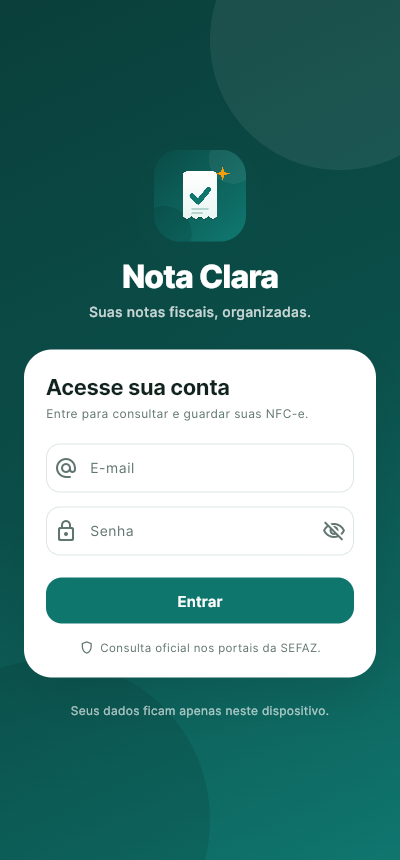
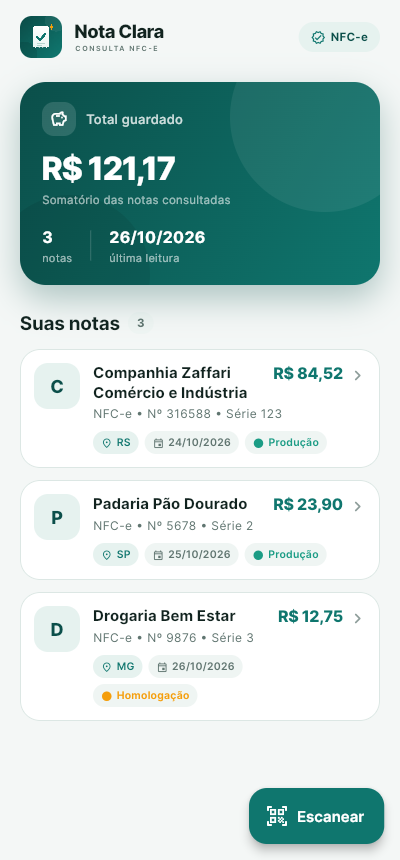
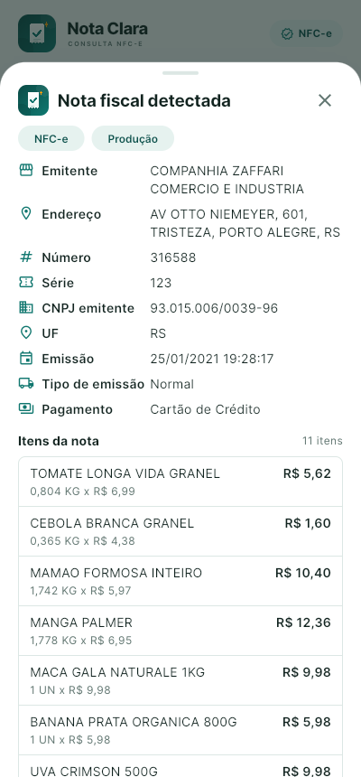

<p align="center">
  
</p>

<h1 align="center">Nota Clara</h1>

<p align="center">
  <a href="https://github.com/ceara-dev/app-consulte-nota-nfce/actions/workflows/android-apk.yml">
    
  </a>
</p>

<p align="center">
  <strong>Suas notas fiscais, organizadas.</strong><br />
  Leia o QR Code da NFC-e, consulte os detalhes no portal da SEFAZ e mantenha
  seu histórico de notas em um só lugar.
</p>

<p align="center">
  
  
  
</p>

## Recursos

- Leitura de QR Code de NFC-e (versões 2, 3 e formato legado `chNFe`), com
  validação da chave de acesso e do dígito verificador.
- Consulta automática ao portal da SEFAZ indicado pelo QR Code: emitente, CNPJ,
  endereço, itens, quantidades, valores, descontos, total e forma de pagamento.
- Histórico local em SQLite com resumo do total guardado e da última leitura.
- Ficha detalhada da nota que pode ser reaberta a qualquer momento pelo histórico.
- Identidade visual própria (Nota Clara), tema Material 3 e fonte Inter.
- Funciona sem back-end: a consulta vai direto do aparelho ao portal oficial.

## Stack

| Camada | Tecnologia |
| --- | --- |
| App | Flutter 3.44.9 / Dart 3.12 |
| Estado | Provider |
| Banco local | SQLite (`sqlite3` + `path_provider`) |
| Câmera / QR | `qr_code_scanner_plus` + `permission_handler` |
| Consulta SEFAZ | `http` + `html` |
| Formatação | `intl` |

## Estrutura

```text
lib/
  database/         conexão, migrações e CRUD do SQLite
  models/           nota salva e detalhes retornados pelo portal
  pages/            login, histórico e câmera
  providers/        estado de login, histórico e leitura
  repository/       acesso aos dados
  services/         parser do QR, consulta à SEFAZ e helpers
  theme/            cores, tipografia e tema Material 3
  wigets/           componentes da marca e da interface
docs/screenshots/   imagens usadas neste README
scripts/            build do APK para avaliação
```

## Rodando localmente

Pré-requisitos:

- Flutter 3.44.9 (o projeto usa FVM; veja `.fvmrc`)
- JDK 17
- Android SDK 35, Build Tools e NDK `27.0.12077973`
- Um dispositivo ou emulador Android

```bash
git clone https://github.com/ceara-dev/app-consulte-nota-nfce.git
cd app-consulte-nota-nfce

fvm install
fvm flutter pub get
fvm flutter run
```

## Gerar o APK para o avaliador

### Opção 1 — GitHub Actions (recomendado)

O workflow [`.github/workflows/android-apk.yml`](.github/workflows/android-apk.yml)
roda `flutter analyze`, `flutter test` e gera o APK release.

1. Abra **Actions → Build APK → Run workflow**.
2. Ao final, baixe o artifact **`nota-clara-apk`** (contém o APK e o arquivo `.sha256`).
3. Instale o APK no aparelho (veja abaixo).

Para publicar uma versão com link permanente, crie e envie uma tag:

```bash
git tag v1.0.0
git push origin v1.0.0
```

O workflow também cria uma [release](https://github.com/ceara-dev/app-consulte-nota-nfce/releases)
com o APK anexado.

### Opção 2 — build local

```bash
./scripts/build_apk.sh          # release
MODE=debug ./scripts/build_apk.sh
```

Saída:

```text
dist/nota-clara-1.0.0-release.apk
dist/nota-clara-1.0.0-release.apk.sha256
```

O script usa `fvm flutter` quando o FVM está disponível, roda `pub get` e copia
o APK gerado para `dist/` com o checksum.

### Instalando no aparelho

Via USB:

```bash
adb install -r dist/nota-clara-1.0.0-release.apk
```

Ou transfira o APK para o celular e permita a instalação de fontes desconhecidas.
O APK é universal (arm64, armv7 e x86_64). Para reduzir o tamanho, gere por ABI:

```bash
fvm flutter build apk --release --split-per-abi
```

### Assinatura

O APK de avaliação usa a chave de **debug** (`android/app/build.gradle`), então
instala em qualquer aparelho, mas **não** serve para publicação na Play Store.
Para uma distribuição de produção, crie um keystore, configure `android/key.properties`
e troque `signingConfig` no bloco `release`.

## Testes e qualidade

```bash
fvm flutter analyze
fvm flutter test
```

A suíte cobre o parser do QR Code (incluindo DV inválido e formatos antigos), a
consulta ao portal com HTML de exemplo e um smoke test da tela de login.

## Como as capturas foram geradas

As imagens de `docs/screenshots/` foram produzidas a partir do build Linux do
próprio app, em uma janela de **400 × 860** (proporção de celular) e sem
decoração de janela.

1. Suba o app no Linux com um banco local contendo três notas de demonstração
   (Zaffari, Padaria Pão Dourado e Drogaria Bem Estar).
2. Para a tela inicial, abra o app direto na rota `/home`.
3. Para a ficha da nota, abra automaticamente a primeira nota da lista e aguarde
   o retorno do portal da SEFAZ.
4. Capture a janela com o ImageMagick:

```bash
WIN_ID=$(xwininfo -root -tree | grep "Nota Clara" | grep -oE '0x[0-9a-f]+' | head -1)
import -window "$WIN_ID" docs/screenshots/home.png
```

5. Depois da captura, as alterações temporárias de rota e abertura automática
   são revertidas e as notas de demonstração são removidas do banco.

> As notas do histórico são apenas dados de demonstração. Nenhum dado pessoal é
> usado nas imagens.

## Limitações

- Portais com captcha ou que dependem de JavaScript podem não devolver os itens;
  nesse caso o app exibe os dados obtidos diretamente do QR Code.
- A consulta automática é permitida apenas para URLs de portais `.gov.br`.
- A NFC-e não traz todos os dados no QR Code; itens e valores dependem do portal.
- O app não envia dados para servidores próprios nem armazena imagens da câmera.

## Privacidade

As notas ficam no banco SQLite local do aparelho. A única comunicação externa é a
requisição HTTP/HTTPS feita ao portal da SEFAZ no momento da consulta.
